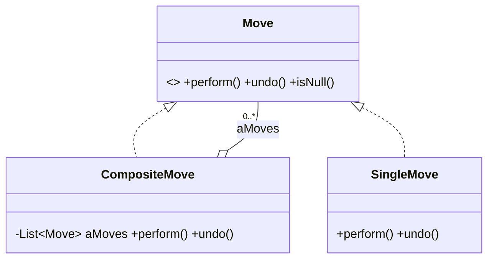
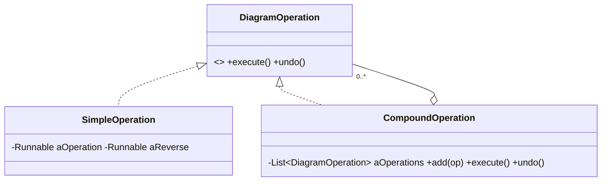
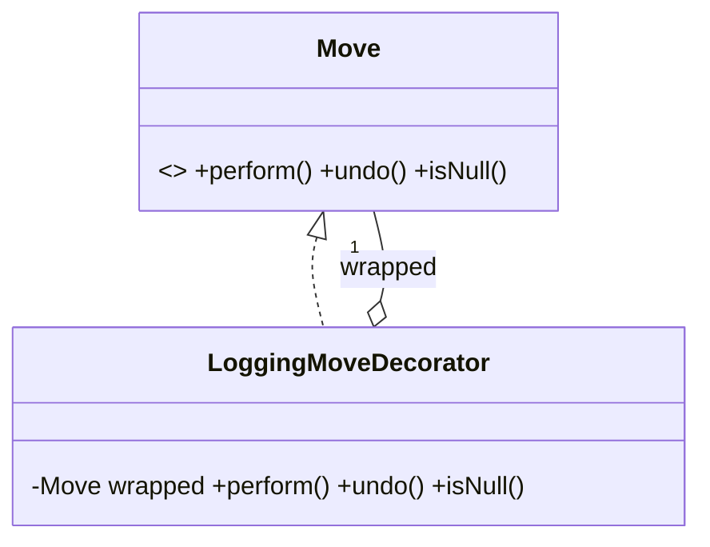
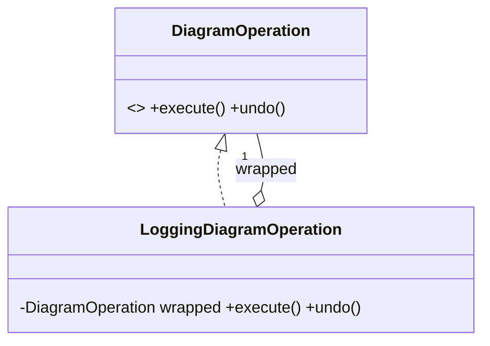

# Sơ đồ UML – giải thích hai mẫu trong hai project

Đây là sơ đồ rút gọn phục vụ phân tích các lớp đã được sao chép nguyên bản.

## Solitaire – Composite (mã gốc)

`SingleMove` trong hình là *vai trò leaf minh họa*, không phải tên lớp sao chép vào project này.

## JetUML – Composite (mã gốc)

## Solitaire – Decorator (đề xuất, không có trong mã gốc)

## JetUML – Decorator (đề xuất, không có trong mã gốc)

